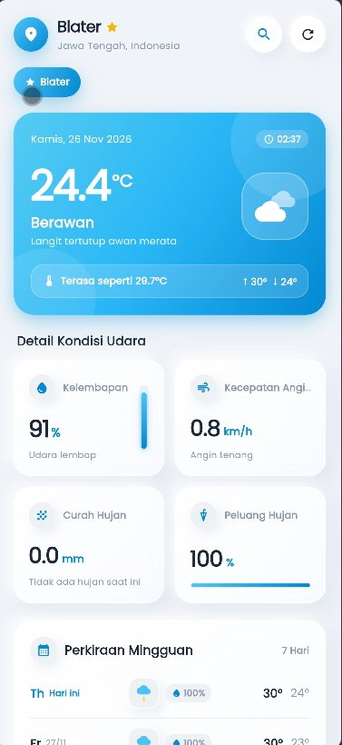
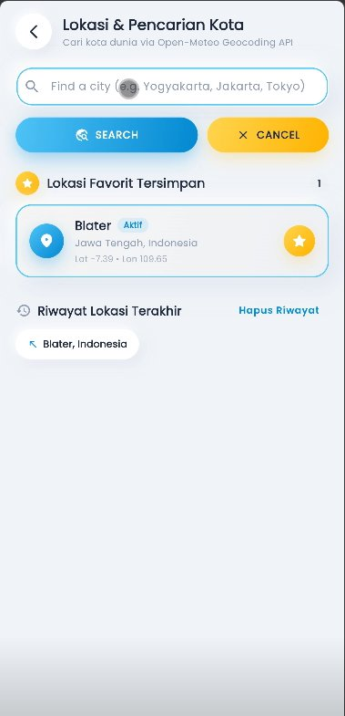

# SkySoft Cuaca — Aplikasi Prakiraan Cuaca Real-Time (Flutter)

Aplikasi prakiraan cuaca modern berbasis **Flutter (Dart)** yang terintegrasi secara *real-time* dengan **Open-Meteo REST API** (Weather Forecast API & Geocoding API). Proyek ini menerapkan pola arsitektur **MVVM (Model-View-ViewModel)** dengan state management **`Provider`**, persistensi lokal **`SharedPreferences`**, serta sistem desain **Material 3 — Light Neumorphism / Soft UI**.

---

## Fitur Utama

- **Informasi Cuaca Real-Time**: Menampilkan suhu saat ini, kondisi cuaca berdasarkan kode WMO (`weather_code`), suhu yang dirasakan (*feels like*), kelembapan udara (dengan *vertical pill progress bar*), kecepatan angin, curah hujan, dan peluang hujan maksimum harian.
- **Prakiraan Cuaca 7 Hari (*Weekly Forecast*)**: Menampilkan daftar perkiraan cuaca harian lengkap dengan singkatan hari (`Mo`, `Tu`, `We`...), ikon cuaca berlapis warna lembut, peluang hujan, serta suhu maksimum dan minimum harian.
- **Pencarian Kota Global (*Geocoding API*)**: Mencari kota di seluruh dunia secara langsung menggunakan metode `HTTP GET` ke endpoint Open-Meteo Geocoding API.
- **Lokasi Favorit & Riwayat Pencarian (*Local Storage*)**: Menyimpan daftar kota favorit, riwayat lokasi pencarian terakhir, dan kota aktif terakhir menggunakan `shared_preferences` sehingga otomatis dimuat kembali saat aplikasi dibuka ulang.
- **Penanganan State Lengkap**: Menangani kondisi **Loading** (indikator pemuatan), **Empty** (hasil kosong), dan **Error** (pesan kendala jaringan beserta tombol `COBA LAGI` / *Retry*).
- **Desain Responsif Soft UI**: Tata letak adaptif untuk layar *smartphone* maupun layar lebar/tablet menggunakan Material 3, bayangan lembut (*soft diffused shadows*), tombol kapsul bergradasi (*pill buttons*), dan tipografi **Poppins** (`google_fonts`).

---

## Cara Menjalankan Proyek

### Prasyarat
- **Flutter SDK** `>= 3.13.0` (teruji pada Flutter `3.47.x` & Dart `3.13.x`)
- Koneksi internet aktif (untuk mengambil data cuaca *real-time* dari Open-Meteo API)
- Emulator Android / iOS, perangkat fisik, atau Chrome / Desktop

### Langkah Menjalankan

1. Masuk ke direktori proyek:
   ```bash
   cd Responsi
   ```

2. Unduh seluruh *dependency* yang dibutuhkan:
   ```bash
   flutter pub get
   ```

3. Jalankan analisis kode statis & pengujian otomatis (opsional):
   ```bash
   flutter analyze
   flutter test
   ```

4. Jalankan aplikasi ke perangkat atau browser pilihan Anda:
   ```bash
   flutter run
   ```

> **Catatan Lingkungan Windows (Opsional)**: Apabila partisi `C:` pada perangkat Anda kehabisan ruang kosong saat mengunduh *package* atau kompilasi sementara, arahkan `PUB_CACHE` dan `TEMP` ke drive proyek (misalnya `D:`):
> ```powershell
> $env:PUB_CACHE="$PWD\.pub-cache"; $env:TEMP="$PWD\.pub-cache\_tmp"; $env:TMP="$PWD\.pub-cache\_tmp"; flutter run
> ```

---

## Struktur Folder Aplikasi (`lib/`)

Proyek diorganisasikan secara modular mengikuti pemisahan tanggung jawab pada arsitektur **MVVM**:

```text
lib/
├── main.dart                         # Entry point aplikasi, konfigurasi MultiProvider & MaterialApp
├── models/                           # Layer Model: struktur data & parsing JSON
│   ├── location_model.dart           # Model lokasi kota (fromJson Geocoding API & toJson Local Storage)
│   ├── weather_condition.dart        # Mapping WMO weather_code (0–99) ke deskripsi & kategori visual ikon
│   └── weather_model.dart            # Model CurrentWeather, DailyForecast, dan agregat WeatherData
├── services/                         # Layer Data Source / Service eksternal
│   ├── local_storage_service.dart    # Persistensi lokasi favorit, lokasi terakhir, & riwayat via SharedPreferences
│   └── weather_api_service.dart      # Klien HTTP GET ke Open-Meteo Geocoding API & Weather Forecast API
├── viewmodels/                       # Layer ViewModel: state aplikasi & logika bisnis (Provider)
│   ├── location_viewmodel.dart       # State pencarian kota, toggle favorit, & riwayat lokasi
│   └── weather_viewmodel.dart        # State pemuatan cuaca (loading/loaded/empty/error), pilih kota, & refresh
├── views/                            # Layer View: halaman utama aplikasi
│   ├── home_screen.dart              # Screen 1: Home / Weather Screen (StatelessWidget)
│   └── search_screen.dart            # Screen 2: Search / Location & Favorites Screen (StatefulWidget)
├── widgets/                          # Komponen antarmuka Soft UI yang reusable
│   ├── hero_weather_card.dart        # Kartu utama cuaca bergradasi biru langit ke cyan + glow shadow
│   ├── location_tile_card.dart       # Kartu item kota hasil pencarian & favorit dengan tombol bintang
│   ├── metric_card.dart              # Kartu metrik udara (termasuk vertical pill progress bar kelembapan)
│   ├── neumorphic_card.dart          # Container dasar Light Neumorphism & tombol ikon bundar
│   ├── pill_button.dart              # Tombol kapsul bergradasi biru (SEARCH/RETRY) & kuning (CANCEL)
│   ├── state_feedback_view.dart      # Tampilan konsisten untuk kondisi Loading, Empty, dan Error
│   ├── weather_icon_badge.dart       # Ilustrasi ikon cuaca Soft UI berlapis warna lembut
│   └── weekly_forecast_card.dart     # Kartu daftar prakiraan cuaca harian (7 hari ke depan)
└── theme/
    └── app_theme.dart                # Konfigurasi Material 3 ThemeData, palet warna, shadow, & tipografi Poppins
```

---

## Implementasi REST API Open-Meteo

Seluruh informasi lokasi dan cuaca diambil secara langsung (*real-time*) menggunakan metode **`HTTP GET`** melalui package `http` di dalam `lib/services/weather_api_service.dart` tanpa data *hardcoded*.

### 1. Geocoding API (Pencarian Lokasi Kota)
- **Endpoint**: `https://geocoding-api.open-meteo.com/v1/search`
- **Metode**: `HTTP GET`
- **Parameter Query**:
  - `name`: kata kunci nama kota yang diketik pengguna
  - `count`: `15` (jumlah hasil maksimum)
  - `language`: `id`
  - `format`: `json`
- **Penanganan Respons**: Array JSON `results` diparsing menjadi `List<LocationModel>`. Apabila key `results` tidak tersedia, aplikasi menanganinya sebagai kondisi **Empty State** (*Lokasi Tidak Ditemukan*).

### 2. Weather Forecast API (Data Cuaca Terkini & Harian)
- **Endpoint**: `https://api.open-meteo.com/v1/forecast`
- **Metode**: `HTTP GET`
- **Parameter Wajib**:
  - `latitude` & `longitude`: koordinat kota yang dipilih
  - `timezone`: `auto`
  - `forecast_days`: `7`
  - `current`: `temperature_2m,relative_humidity_2m,apparent_temperature,precipitation,weather_code,wind_speed_10m`
  - `daily`: `weather_code,temperature_2m_max,temperature_2m_min,precipitation_probability_max`

| Informasi UI | Field JSON Open-Meteo | Model Dart | Satuan |
| :--- | :--- | :--- | :--- |
| Suhu saat ini | `current.temperature_2m` | `CurrentWeather.temperature2m` | `°C` |
| Kelembapan udara | `current.relative_humidity_2m` | `CurrentWeather.relativeHumidity2m` | `%` |
| Suhu yang dirasakan | `current.apparent_temperature` | `CurrentWeather.apparentTemperature` | `°C` |
| Curah hujan | `current.precipitation` | `CurrentWeather.precipitation` | `mm` |
| Kondisi & ikon cuaca | `current.weather_code` | `CurrentWeather.condition` | Kode WMO |
| Kecepatan angin | `current.wind_speed_10m` | `CurrentWeather.windSpeed10m` | `km/h` |
| Suhu maksimum harian | `daily.temperature_2m_max` | `DailyForecast.temperatureMax` | `°C` |
| Suhu minimum harian | `daily.temperature_2m_min` | `DailyForecast.temperatureMin` | `°C` |
| Peluang hujan maks | `daily.precipitation_probability_max` | `DailyForecast.precipitationProbabilityMax` | `%` |

---

## Penerapan Arsitektur MVVM & State Management

Aplikasi memisahkan logika bisnis dari kode antarmuka melalui pola **Model-View-ViewModel (MVVM)** berbasis `ChangeNotifier` dan `Provider`:

```text
[ View: HomeScreen / SearchScreen ]
        │  ▲
        │  │  (context.watch / Rekomposisi UI otomatis saat notifyListeners)
  Aksi  │  │
  User  ▼  │
[ ViewModel: WeatherViewModel & LocationViewModel ]
        │  ▲
        │  │  (Model Dart: WeatherData & LocationModel)
        ▼  │
[ Service: WeatherApiService (HTTP GET) & LocalStorageService (SharedPreferences) ]
```

1. **Model (`lib/models/`)**: Bertugas merepresentasikan struktur data murni (`LocationModel`, `WeatherData`, `CurrentWeather`, `DailyForecast`, dan `WeatherConditionInfo`) beserta konversi JSON (`fromJson` / `toJson`).
2. **Service (`lib/services/`)**: Menangani akses sumber data eksternal (`WeatherApiService` untuk komunikasi jaringan ke Open-Meteo beserta konversi *network timeout/socket error* ke `WeatherApiException`, dan `LocalStorageService` untuk baca/tulis data JSON ke `SharedPreferences`).
3. **ViewModel (`lib/viewmodels/`)**:
   - `WeatherViewModel` mengelola siklus state pengambilan cuaca (`initial`, `loading`, `loaded`, `empty`, `error`), sinkronisasi kota terakhir di penyimpanan lokal, serta fitur *pull-to-refresh*.
   - `LocationViewModel` mengelola state pencarian kota (`idle`, `loading`, `loaded`, `empty`, `error`), penambahan/penghapusan kota favorit, dan pencatatan riwayat pencarian.
4. **View (`lib/views/` & `lib/widgets/`)**:
   - `HomeScreen` dibangun sebagai `StatelessWidget` karena seluruh perubahannya bersumber dari ViewModel melalui `context.watch<WeatherViewModel>()`.
   - `SearchScreen` dibangun sebagai `StatefulWidget` khusus untuk mengelola objek lokal input teks (`TextEditingController` & `FocusNode`) secara bersih pada `initState` dan `dispose`.

---

## Screenshots Aplikasi

| Home Screen | Search Screen |
| :---: | :---: |
|  |  |
| *Tampilan cuaca terkini, metrik kondisi udara, & prakiraan mingguan* | *Pencarian kota via Geocoding API, lokasi favorit, & riwayat pencarian* |

---

## Daftar Dependency Utama (`pubspec.yaml`)

- [`http`](https://pub.dev/packages/http) — Request REST API metode `HTTP GET` ke server Open-Meteo
- [`provider`](https://pub.dev/packages/provider) — Pengelolaan state reaktif untuk arsitektur MVVM
- [`shared_preferences`](https://pub.dev/packages/shared_preferences) — Penyimpanan lokal lokasi favorit, kota terakhir, & riwayat pencarian
- [`intl`](https://pub.dev/packages/intl) — Pemformatan waktu dan tanggal prakiraan cuaca
- [`google_fonts`](https://pub.dev/packages/google_fonts) — Tipografi modern *Poppins* pada sistem desain Material 3
